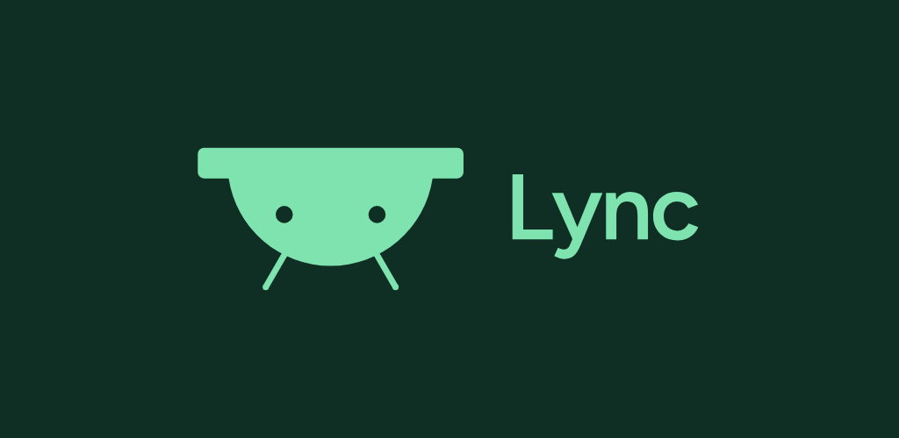

<p align="center"></p>

# Lync

Your Android phone and your Mac, together. Lync lives in your Mac's notch (or menu bar) and brings your
phone to it:

- **One-time codes, already copied.** Login codes from SMS or any app land on your Mac's clipboard.
- **Calls.** See who's calling and answer or decline from the Mac.
- **Texts and notifications.** Read and reply to SMS, and mirror notifications from the apps you pick.
- **Send anything.** Files, photos and links in both directions, from the share sheet or by dropping on the notch.
- **Ring your phone** from the Mac, even on silent.

No accounts, no cloud, no tracking. The phone talks only to your own Mac, directly over your Wi-Fi,
end-to-end encrypted. See the [privacy policy](docs/PRIVACY.md).

## Requirements

- Android 10 or later
- macOS 14 or later, on the same Wi-Fi network

## Build

**Android** (Android Studio, or its bundled JDK):

```sh
cd android
./gradlew :app:assembleDebug        # debug APK
./gradlew :app:bundleRelease        # Play bundle (signed if lync.signing is set, see docs/PLAY_STORE.md)
```

**Mac:**

```sh
cd mac
./scripts/build-app.sh              # builds build/Lync.app and Lync.dmg
```

## Docs

- [Link protocol](docs/PROTOCOL.md)
- [Design notes](docs/DESIGN.md)
- [Publishing on Google Play](docs/PLAY_STORE.md)
- [Logo and brand kit](brand/kit/README.md)
